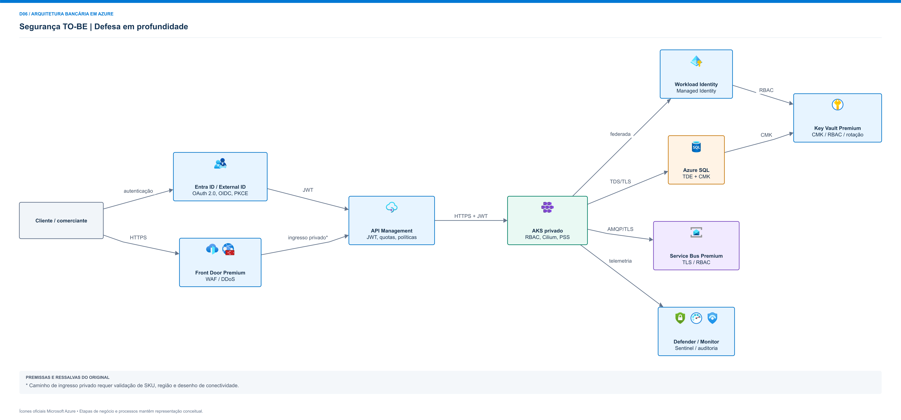
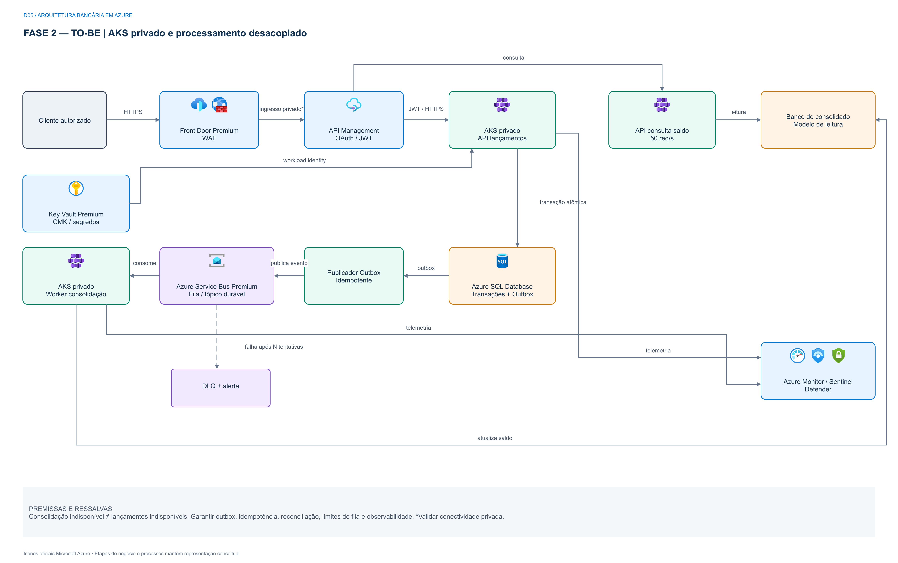

# MVP Bancário na Azure · Arquitetura de Cybersecurity e de Solução

> **Cenário fictício para avaliação técnica.** A arquitetura proposta é para um MVP bancário hipotético. O material não descreve o ambiente de nenhuma instituição real, não contém dados reais e não afirma que algum controle foi implantado.

**Autor:** Rodrigo Soares Reis · **Versão:** 1.0 · **Data:** 16/11/2026

---

## O desafio

Um comerciante registra débitos e créditos (serviço de **lançamentos**) e consulta o saldo diário (serviço de **consolidado diário**). Os requisitos não funcionais do enunciado são três:

- o serviço de lançamentos **não pode ficar indisponível** quando o consolidado falha;
- o consolidado recebe **50 requisições por segundo** em pico;
- a perda de requisições no consolidado pode chegar a **no máximo 5%**.

## A abordagem

O foco desta entrega é **Cybersecurity**. A arquitetura de solução vem antes para mostrar o cenário completo: domínios, fluxos, integrações e capacidade. A arquitetura de segurança é construída em cima dela.

Faltam dados do ambiente real, então o desenho traz **dois cenários** ligados por um gate de segurança:

| | Fase 1 · Secure & Stabilize | Fase 2 · Modernize & Scale |
|---|---|---|
| Cenário | **A:** monólito moderno protegido em Azure IaaS | **B:** microsserviços em AKS privado (Strangler Fig) |
| Isolamento lançamento × consolidado | Pools e rotas separados no APIM, leitura em réplica | Serviços e bancos separados, Outbox + Service Bus |
| Segurança | Zero Trust, PIM/JIT, WAF, APIM, hub-spoke, Key Vault + CMK, Sentinel | Tudo da Fase 1 + workload identity, network policy, admissão de imagem assinada |



## Conteúdo do repositório

```text
.
├── README.md
├── documentos/
│   ├── Ebook_Arquitetura_de_Cybersecurity.pdf   ← documento principal
│   └── Ebook_Arquitetura_de_Solucao.pdf
├── apresentacoes/
│   ├── Apresentacao_Arquitetura_Cybersecurity.pdf
│   └── Apresentacao_Arquitetura_Solucao.pdf
└── diagramas/
    └── D01 a D15 (PNG)
```

| Arquivo | O que tem |
|---|---|
| [E-book de Cybersecurity](documentos/Ebook_Arquitetura_de_Cybersecurity.pdf) | HLD e LLD de segurança do AS-IS, da Fase 1 e da Fase 2; identidade, APIs, criptografia, CMK e PKI; dados DEV/QA/PROD; DevSecOps; STRIDE e riscos; conformidade (LGPD, CMN/BCB, PCI DSS condicional); HA/DR; **estratégia e plano de testes de segurança** |
| [E-book de Solução](documentos/Ebook_Arquitetura_de_Solucao.pdf) | Requisitos refinados, domínios e capacidades, AS-IS, TO-BE, fluxo transacional, dados e ambientes, sizing, **plano de testes**, roadmap e custos, ADRs |
| [Apresentação de Cybersecurity](apresentacoes/Apresentacao_Arquitetura_Cybersecurity.pdf) | Defesa executiva e técnica da arquitetura de segurança |
| [Apresentação de Solução](apresentacoes/Apresentacao_Arquitetura_Solucao.pdf) | Defesa da arquitetura de solução e da transição |
| [Diagramas](diagramas/) | D01–D15 com ícones oficiais Microsoft Azure |

### Por onde começar

| Tempo disponível | Leitura |
|---|---|
| 10 minutos | Apresentação de Cybersecurity |
| 30 minutos | E-book de Cybersecurity: Apresentação e capítulos 01, 04, 08 e 14 |
| 1 hora ou mais | Os dois e-books |

## Como a solução funciona

```text
Comerciante ──HTTPS──► Front Door Premium (WAF) ──Private Link──► API Management (JWT, rate limit)
                                                                      │
                     POST /lancamentos ◄──────────────────────────────┤
                            │                                         │ GET /consolidado
                            ▼                                         ▼
               Azure SQL (lançamento + outbox,              API do consolidado ──► modelo de leitura
                    mesma transação)                                                    ▲
                            │                                                           │
                    publicador da outbox ──► Service Bus Premium ──► consolidador ──────┘
                                                   └──► DLQ + alerta
```

1. O lançamento é gravado **com o evento na mesma transação** (Transactional Outbox). A resposta ao cliente só depende do banco de lançamentos.
2. O evento chega ao consolidador pelo **Service Bus**, com entrega garantida, DLQ e idempotência por `event_id`.
3. Se o consolidador, o modelo de leitura ou a própria fila caírem, **os lançamentos continuam sendo aceitos**. Os eventos esperam e são processados quando o serviço volta.
4. A consulta do consolidado lê um modelo pré-calculado, com indicação de "atualizado até". Nenhuma consulta pesa sobre a base de lançamentos.
5. Toda chamada é autenticada (OAuth 2.0/OIDC) e autorizada por objeto: o comerciante vem do token, nunca do corpo da requisição.



## Testes

Esta entrega é de arquitetura e não inclui código executável. Os testes estão definidos em planos com casos, critério de aceite e evidência esperada:

| Plano | Onde | Destaques |
|---|---|---|
| **Segurança** | E-book de Cybersecurity, cap. 14 | 44 casos (TS-01 a TS-53): esteira (SAST, SCA, segredos, IaC, imagem), OWASP API Top 10, tokens, BOLA/IDOR, TLS, segmentação, admissão no AKS, revogação controlada de CMK, dados sem PII em log, simulação de ataque com detecção no Sentinel (MITRE ATT&CK), pentest anual |
| **Solução** | E-book de Solução, cap. 06 | Funcionais, contrato (OpenAPI e schema de evento), integração Outbox → Service Bus, **50 req/s sustentadas**, caos com o consolidado fora do ar, reconciliação |

Critérios centrais de aceite:

- **0 lançamentos rejeitados** com o consolidado, a fila ou o modelo de leitura fora do ar;
- **≥ 50 req/s sustentadas** no consolidado, com perda ≤ 1% (meta) e nunca acima de 5%;
- **0 divergências** na reconciliação depois da recuperação;
- **0 acessos** a dados de outro comerciante nos testes negativos.

## Como rodar localmente

### A documentação

Não há dependência nem instalação:

1. Clique em **Code → Download ZIP**, ou clone o repositório com `git clone <url-do-repositório>`.
2. Abra os PDFs em `documentos/` e `apresentacoes/` em qualquer leitor de PDF.
3. Os diagramas em `diagramas/` são imagens PNG em alta resolução.

### A aplicação (ambiente local de referência)

O código está fora do escopo desta entrega. O ambiente local de desenvolvimento foi desenhado para rodar **sem nenhum recurso de nuvem e sem dado real**, com contêineres:

| Componente | Papel |
|---|---|
| `svc-lancamentos` | API de lançamentos (escrita), com outbox |
| `outbox-publisher` | Publica os eventos pendentes da outbox |
| `svc-consolidador` | Consome os eventos e atualiza o modelo de leitura |
| `svc-consolidado-api` | API de consulta do saldo diário |
| SQL Server em contêiner | Bancos de lançamentos e do consolidado |
| Emulador do Azure Service Bus | Tópico, assinatura e DLQ locais |
| Provedor OIDC local | Tokens de teste com os escopos `lancamentos.write` e `consolidado.read` |
| Gerador de massa sintética | Comerciantes e lançamentos fictícios |

Roteiro previsto:

1. Subir a infraestrutura local (`docker compose up`).
2. Carregar a massa sintética (até 100 mil comerciantes fictícios).
3. Obter um token no provedor OIDC local e chamar `POST /v1/lancamentos` com `Idempotency-Key`.
4. Consultar `GET /v1/consolidado/{data}` e conferir o campo "atualizado até".
5. Parar o `svc-consolidador`, continuar lançando e confirmar que os lançamentos seguem aceitos. Subir de novo e conferir a reconciliação.

## Principais decisões

| Decisão | Por quê |
|---|---|
| Proteger antes de modernizar | Ganho de segurança em semanas; modernização decidida com dados medidos |
| Lançamento nunca depende do consolidado | Requisito do enunciado e controle de disponibilidade |
| Service Bus + Outbox, não Event Grid | Fila durável, DLQ e idempotência para dado financeiro |
| CMK no Key Vault Premium (HSM) | Controle e revogação; a chave é tratada como dependência de disponibilidade |
| Identidades de workload sem segredo | Elimina a classe "segredo vazado" |
| Azure Firewall só onde há rota | Inspeção onde o tráfego passa de fato; entrada protegida por WAF, Private Link e APIM |
| DR condicionado à residência de dados | O par de Brazil South fica nos EUA; a chave CMK não restaura fora da geografia |

As 16 decisões completas, com alternativas descartadas, estão nos anexos dos e-books.

## Evoluções futuras

- Implementação de referência dos quatro serviços e do ambiente local descrito acima.
- Execução dos planos de teste, com os resultados publicados.
- Estimativa de custo em moeda, a partir dos SKUs definidos no benchmark de QA.
- Diagramas complementares após o assessment do ambiente real: fronteiras de confiança do AS-IS, LLD de políticas do AKS e DFD de STRIDE.

---

Material de avaliação técnica, não oficial. Os nomes de produtos citados pertencem aos respectivos fabricantes.
